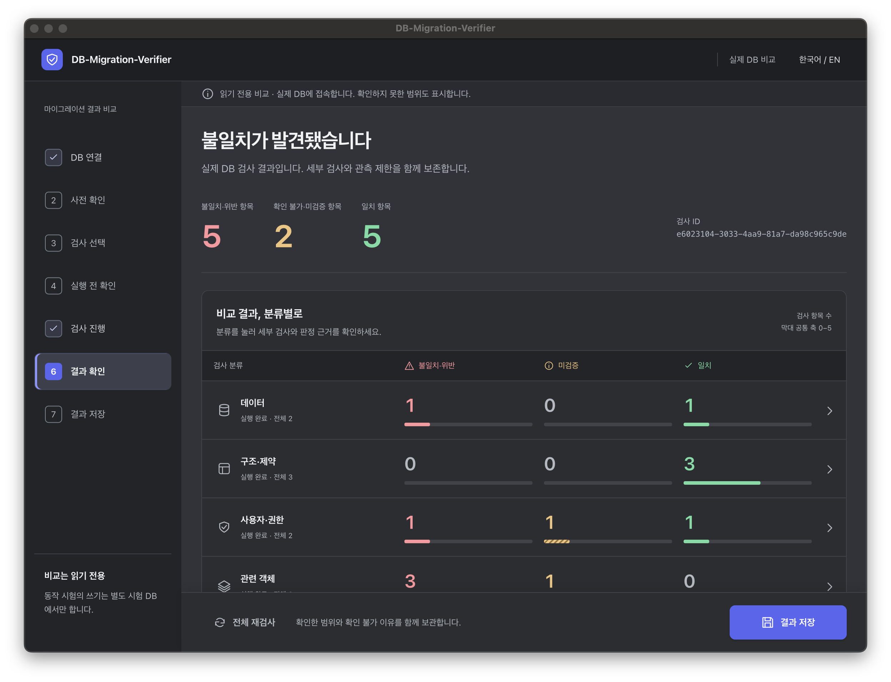

DB-Migration-Verifier User Guide
================================

|readme-ko| |readme-en| |guide-ko| |guide-en|

.. |readme-ko| image:: https://img.shields.io/badge/README-%ED%95%9C%EA%B5%AD%EC%96%B4-0057B8?style=for-the-badge
   :target: ../README.ko.rst
   :alt: README 한국어

.. |readme-en| image:: https://img.shields.io/badge/README-English-0057B8?style=for-the-badge
   :target: ../README.rst
   :alt: README English

.. |guide-ko| image:: https://img.shields.io/badge/%EC%82%AC%EC%9A%A9%20%EC%84%A4%EB%AA%85%EC%84%9C-%ED%95%9C%EA%B5%AD%EC%96%B4-087F8C?style=for-the-badge
   :target: USER_GUIDE.ko.rst
   :alt: 사용 설명서 한국어

.. |guide-en| image:: https://img.shields.io/badge/USER%20GUIDE-English-087F8C?style=for-the-badge
   :target: USER_GUIDE.en.rst
   :alt: User guide English

Applies to v0.1.0-preview.1 · October 14, 2026

Follow this guide to compare two databases and keep the result.
See the `English README <../README.rst>`_ for the verified engine/platform coverage.

1. Download and launch
----------------------

Open the `public release <https://github.com/Comparison-of-Migrations/DB-Migration-Verifier/releases/tag/v0.1.0-preview.1>`_
and choose your platform.

* macOS Apple Silicon: extract ``DB-Migration-Verifier-macos-arm64.zip`` into a new
  folder and open ``DB-Migration-Verifier.app``.
* Windows x64: extract ``DB-Migration-Verifier-win-x64.zip`` into a new folder and
  open ``Verifier.Desktop.exe``. Keep the accompanying files together.
* The .NET runtime is included. No SDK installation or app account is required.
* These preview builds are unsigned and not notarized. Review any OS protection
  message that prevents startup; a trusted signed distribution is not yet available.

Use the language control at the top right to switch between Korean and English.

2. Choose a home action
-----------------------

* **Start a new check:** connect to two actual databases and compare them.
* **Open a result file:** open a JSON result saved by the app, without running a new comparison.
* **View example results:** explore the screens without a database. Examples are not DB verification evidence.
* **Saved inspection history:** browse JSON results saved or opened on this device.

3. Connect source and target
----------------------------

1. Prepare two distinct databases of the same DBMS.
2. Actually stop writes to both databases, then confirm this in the connection screen.
3. Enter the host, port, database, query account, and password for each side.
4. Configure certificate paths under advanced connection settings if needed.
5. Check both connections and read the verification state or corrective error.

.. list-table:: Common default ports — use your actual server configuration
   :header-rows: 1

   * - DBMS
     - Port
   * - PostgreSQL
     - 5432
   * - SQL Server
     - 1433
   * - MySQL / MariaDB
     - 3306

For PostgreSQL, MySQL, and MariaDB, the certificate input is a CA path used for
server authentication. SQL Server uses an **exact public server-certificate match**,
which is different from a CA certificate. Leaving the SQL Server path empty uses
OS certificate trust. Correct invalid or expired certificates and hostname mismatches
before checking the connections again.

After changing connection settings or loading saved settings, check both sides again.
If source and target identify the same actual database, select distinct databases.

Save connection settings on this device
~~~~~~~~~~~~~~~~~~~~~~~~~~~~~~~~~~~~~~~

After verifying both connections, you can save the connection settings. By default,
only host, port, database, account, and certificate paths are saved. Selecting the
option to save passwords stores them in the OS credential store. After loading
settings, confirm stopped writes and check both connections again.

Deleting saved connections removes the stored settings and associated OS password
entries. Current inputs remain in memory until you clear them or close the app.

4. Review capabilities and choose scope
---------------------------------------

Preflight shows the observable scope and its limits. Limited observations retain
their reasons; an area that could not be checked is not treated as equal.

Choose check categories, table scope, and the database scope offered by the adapter.
Search tables and inspect the source/target table and column mappings. Use the
available mapping controls to correct an unsuitable automatic match.

Before running, review the selected checks, mappings, limitations, and trial scope.
If you change the selection, review the updated summary before proceeding.

5. Optional behavior checks in a separate DB
--------------------------------------------

Ordinary comparison only reads source and target. To use behavior checks, prepare
a trial DB separate from both, then review its table, inputs, expected outcomes,
and required parent data. Confirm the preparation before returning to the selection.

Some constraints or additional inputs cannot be prepared automatically for every
engine or structure. Leave a case unexecuted and retain its reason when you cannot
confirm it. Confirmed behavior checks perform writes only in the separate trial DB.

6. Run and interpret the result
-------------------------------

The running screen shows the current stage and processing position. After a
cancellation request, unfinished scope can remain unverified. Distinguish:

* **Differences / violations:** an observed value, definition, or structure differs,
  or an integrity violation was found.
* **Unverified / unknown:** privileges, observation limits, support boundaries,
  cancellation, or other stated reasons prevented a complete verdict.
* **Equal:** the scope observed by that check matches.

A check with both a known difference and an unverified observation can contribute
to both totals. Bars and totals count checks; they are not row counts or a database-wide
success rate. Open a category or item for check IDs, locations, evidence, and limit reasons.

7. Save and reopen
------------------

Select the output formats and file locations on the save screen.

* **JSON:** preserves the run identity, verdicts, and findings for reopening in the app.
* **CSV:** a tabular report for reading or sharing.
* **HTML:** a report for reading or sharing in a browser.

When choosing several formats, complete each save dialog. If a save is cancelled
or fails, check which formats the app reports as completed. Review identifying
information such as database and object names before sharing.

Use the home screen's result-file action to open JSON and confirm the original
run ID and verdicts. Opening a file restores the recorded result; it does not
rerun checks against the current databases.

You can also open a result from saved inspection history. A moved, changed, or
damaged file may no longer open from its record; choose the original valid file
directly. **Remove record only** removes the history entry and retains the original file.

8. Troubleshooting
------------------

.. list-table:: First things to check
   :header-rows: 1
   :widths: 30 70

   * - Symptom
     - Action
   * - Connections remain unverified
     - Check required inputs and the actual stopped-write state, then verify both connections again.
   * - Connection or certificate error
     - Check host, port, database, account/password, certificate type/path/validity, and hostname.
   * - Observation limit
     - Read the check's detailed reason, query privileges, and supported scope.
   * - Trial cannot be confirmed
     - Review DB separation, inputs, expected outcomes, constraints, and parent data; leave the case unexecuted if needed.
   * - Result file cannot be opened
     - Use valid JSON saved by the app and check that it has not been moved, changed, or damaged.

For `issue reports <https://github.com/Comparison-of-Migrations/DB-Migration-Verifier/issues/new/choose>`_,
include the app version, OS/architecture, DB engine/version, reproduction steps,
and sanitized errors. Do not include passwords, keys, customer data, or production dumps.

Current preview limits
----------------------

Trusted signing/notarization, native Windows x64 hardware acceptance, positive EKM,
and full production/scale qualification remain open. Keep the limitations and
unverified reasons with the result. See the `English README <../README.rst>`_
for precise evidence scope and licensing.
